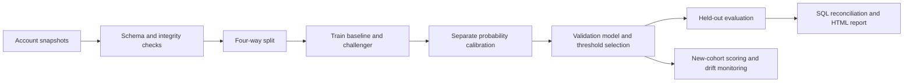

# Credit Risk Modelling Toolkit

[](https://github.com/abhinavbhatia2006/credit-risk-modelling-toolkit/actions/workflows/tests.yml)

[](LICENSE)

**Credit-card default modeling, independent validation, and portfolio monitoring from the terminal.**

A Python/SQL risk analytics workbench with an interpretable logistic baseline, a boosted-tree challenger, probability calibration, held-out evaluation, drift investigation, and reproducible business reports. The installed command is `creditrisk`.

## Highlights

- Four-way data separation: training, calibration, model selection, and final testing.
- ROC-AUC, KS, average precision, Brier score, calibration plots, bootstrap intervals, and segment diagnostics.
- Reference-fitted Population Stability Index (PSI) monitoring with labeled or unlabeled cohorts.
- Independent SQLite/pandas reconciliation of portfolio report totals.
- Self-contained HTML reports, model cards, source hashes, and reproducible configuration.
- Offline synthetic demo, an attributed public-data adapter, and 29 automated tests.

## Measured results

On the UCI credit-card dataset, the selected calibrated boosting model produced these results on **4,500 held-out accounts** from **30,000 records**:

| Metric | Test result |
|---|---:|
| ROC-AUC | 0.7708 |
| ROC-AUC 95% bootstrap interval | 0.7552-0.7889 |
| Average precision | 0.5367 |
| KS | 0.4144 |
| Brier score | 0.1376 |
| Constant-risk baseline Brier | 0.1723 |

The source is a Taiwanese credit-card cohort from 2005. These are random-holdout research results, not evidence of US-portfolio or future-period performance. See [full results and limitations](docs/RESULTS.md).

## Installation

Requires **Python 3.11+**. No database server or API key is needed.

```bash
git clone https://github.com/abhinavbhatia2006/credit-risk-modelling-toolkit.git
cd credit-risk-modelling-toolkit
python -m venv .venv
```

Windows PowerShell:

```powershell
.\.venv\Scripts\python.exe -m pip install -e ".[dev]"
```

macOS/Linux (use `python3` for environment creation if needed):

```bash
.venv/bin/python -m pip install -e ".[dev]"
.venv/bin/creditrisk demo --out runs/my-demo
```

## Start here (Windows PowerShell)

After installation, from the repository root:

```powershell
.\.venv\Scripts\creditrisk.exe --help
.\.venv\Scripts\creditrisk.exe demo --out runs/my-demo
Start-Process runs/my-demo/model/report.html
Start-Process runs/my-demo/monitoring/report.html
```

The demo runs offline. Use a new output folder for each run; existing nonempty dataset and model directories are protected from accidental replacement.

For the exact tested Python 3.13 dependency versions, use the optional lock file instead of resolving dependency ranges:

```powershell
.\.venv\Scripts\python.exe -m pip install -r requirements-lock.txt
.\.venv\Scripts\python.exe -m pip install -e . --no-deps --no-build-isolation
.\.venv\Scripts\python.exe -m pytest -q
```

Downloaded data, virtual environments, trained models, and generated reports are intentionally excluded from Git. Run the commands below to reproduce them locally. Small synthetic CSV examples are included under `examples/`.

## Pipeline



## Real-data workflow

```powershell
.\.venv\Scripts\creditrisk.exe fetch-data --out data/uci
.\.venv\Scripts\creditrisk.exe validate-data --input data/uci/accounts.csv --out data/uci/validation.json
.\.venv\Scripts\creditrisk.exe train --input data/uci/accounts.csv --config configs/default.json --out runs/uci
.\.venv\Scripts\creditrisk.exe evaluate --model runs/uci/model.joblib --input runs/uci/test.csv --out runs/uci-recheck
.\.venv\Scripts\creditrisk.exe score --model runs/uci/model.joblib --input runs/uci/test.csv --out runs/scored
.\.venv\Scripts\creditrisk.exe audit --input runs/scored/predictions.csv --out runs/scored/audit
.\.venv\Scripts\creditrisk.exe scenario --model runs/uci/model.joblib --input runs/uci/test.csv --lgd 0.6 --pd-multiplier 1.5 --out runs/uci-scenario
.\.venv\Scripts\creditrisk.exe report --run runs/uci
```

`fetch-data` downloads the official UCI ZIP. For offline import supply `--archive path/to/source.zip`. Attribution and SHA-256 are stored with the data. The public dataset contains Taiwanese credit-card customers from 2005, not Citi or US customers. Its single cohort supports a random holdout, not an out-of-time test. Do not rename this result as a US-portfolio model.

## Monitoring

```powershell
.\.venv\Scripts\creditrisk.exe monitor --model runs/my-demo/model/model.joblib --reference runs/my-demo/model/train.csv --current runs/my-demo/data/current.csv --out runs/new-monitor
```

Reference-fitted bins measure feature and score PSI, including an explicit missing-data bin. Watch/alert thresholds are configurable heuristics. Outcomes are optional: without labels, the report omits performance claims. The demo deliberately shifts the current synthetic cohort. This demonstrates drift detection, not a real-world deterioration finding. This version requires disjoint customer cohorts; repeated-account longitudinal monitoring is a documented extension.

## Methodology

1. **Validate:** unique account snapshots, required fields, finite values, status ranges, positive limits, binary labels. Additional columns are excluded by an explicit predictor allowlist.
2. **Split:** default 55% training, 15% calibration, 15% selection/validation, 15% untouched test, stratified by outcome. Temporal mode supports user-supplied dates with label-horizon purging at each boundary.
3. **Engineer:** utilization, repayment-to-balance ratios, delinquency summaries, and balance change. Median imputation and scaling are fitted only on training rows.
4. **Fit:** logistic regression and histogram gradient boosting. No SMOTE or class weighting distorts the target prevalence.
5. **Calibrate:** fit separate sigmoid/log-odds calibration on the calibration partition. Compare raw and calibrated candidates on validation Brier score, breaking ties by log loss.
6. **Select threshold:** minimize illustrative false-negative/false-positive cost on validation only. The flag means human review, not automatic lending action.
7. **Evaluate once:** test ROC-AUC and bootstrap interval, average precision, KS, Brier, log loss, confusion matrix, reliability bins and segment diagnostics. Compare Brier against a constant training-prevalence baseline.
8. **Explain:** validation permutation importance and standardized logistic coefficients. Importance is predictive, not causal.
9. **Reconcile:** SQLite and pandas independently aggregate the same scored file. This verifies report arithmetic; it does not verify the upstream source.
10. **Monitor and report:** drift and available outcomes, HTML reports with embedded plots, CSV/JSON artifacts, model card, source/model hashes and environment versions.

To use temporal mode, set `split` to `temporal`, `date_column` to your observation-date column, and `label_horizon_days` to the actual label window. The adapter never invents timestamps for the UCI data. Each temporal partition must still contain both outcomes and at least 30 rows; snapshots whose label windows reach the next partition are purged. The source owner must ensure test outcomes have matured.

## Commands and outputs

| Command | Purpose |
|---|---|
| `demo` | Entire offline workflow |
| `generate-data` | Seeded synthetic development/current cohorts |
| `fetch-data` | Official UCI import and attribution |
| `validate-data` | Schema and integrity checks; exit 2 on invalid data |
| `train` | Fit, calibrate, select, test, audit and report |
| `evaluate` | Labeled independent cohort; rejects development account overlap |
| `score` | Probabilities and review flags; labels optional |
| `monitor` | Reference/current drift and available performance |
| `audit` | SQL-versus-pandas report reconciliation |
| `scenario` | Explicitly assumed PD/LGD/exposure loss sensitivity |
| `report` | Regenerate portable HTML and model card |

Machine-readable JSON goes to stdout; progress/errors go to stderr. Exit 0 means success and 2 means invalid input or a failed check. `--debug` (before the command) enables tracebacks. `report`, `audit`, and `scenario` regenerate their named derived outputs; training, scoring, evaluation, monitoring and data generation require new/empty directories.

Each training run includes `model.joblib`, four split CSVs, `manifest.json`, effective `config.json`, validation comparison, threshold curve, feature importance, coefficients, test predictions/metrics, calibration/segments, `audit/portfolio.sqlite`, `audit/reconciliation.sql`, `MODEL_CARD.md`, and a self-contained `report.html`.

## Project layout

```text
src/creditrisk/    CLI, data contracts, modeling, metrics, monitoring, SQL audit, reports
configs/          Reproducible model/split/cost settings
tests/            Statistical, leakage, data-contract and end-to-end tests
docs/             Data dictionary, methodology, interview guide, measured results
examples/         Small input templates
data/             Downloaded/generated data (gitignored)
runs/             Models and generated reports (gitignored)
```

## Testing

```powershell
.\.venv\Scripts\python.exe -m pytest -q
.\.venv\Scripts\python.exe -m ruff check src tests scripts
```

Tests cover data-contract failures, feature leakage prevention, disjoint and temporal splits, calibration/discrimination metrics, constant-reference drift, model serialization, train-only preprocessing, unlabeled monitoring, reconciliation, and CLI behavior. GitHub Actions runs the suite on Windows and Linux with Python 3.11 and 3.13.

## Documentation

- [Input schema and feature definitions](docs/DATA_DICTIONARY.md)
- [Measured results and limitations](docs/RESULTS.md)
- [Design decisions and walkthrough](docs/INTERVIEW_GUIDE.md)
- [Default model, split, cost, and monitoring settings](configs/default.json)

## Scope and responsible interpretation

- This is a research portfolio project, not a production underwriting system or regulatory model.
- Loss sensitivity is a one-month illustration using latest positive bill balance as an exposure proxy and user-assumed LGD. It is **not** a lifetime CECL reserve or CCAR implementation.
- Excluding demographics does not establish fairness. Proxy discrimination, population transportability, source-time leakage and label maturity require further review.
- Model files use joblib/pickle. Load only artifacts you created or otherwise trust.
- CLI inputs and output paths are local; no customer data is uploaded. Only `fetch-data` requires networking.
- The test set is not a tuning set. Re-running evaluation is for reproducibility; changing the model after inspecting test results requires a new final validation cohort.

## Sources

- Yeh, I. (2009). **Default of Credit Card Clients** [Dataset]. UCI Machine Learning Repository. [DOI: 10.24432/C55S3H](https://doi.org/10.24432/C55S3H), [dataset and CC BY 4.0 license](https://archive.ics.uci.edu/dataset/350/default+of+credit+card+clients). Adaptations: column renaming, financial feature selection, derived ratios and split preparation.
- [Scikit-learn probability calibration](https://scikit-learn.org/stable/modules/calibration.html).
- [Scikit-learn cross-validation](https://scikit-learn.org/stable/modules/cross_validation.html).

Source code is MIT licensed. The UCI data retains its separate CC BY 4.0 license.
